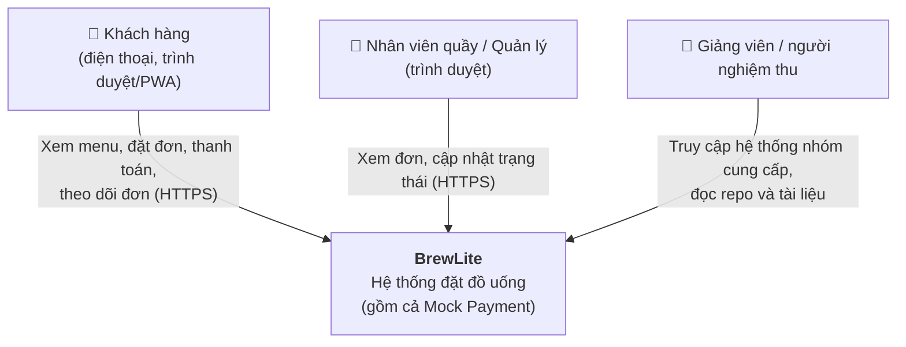
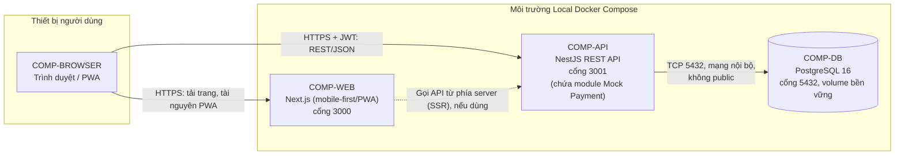
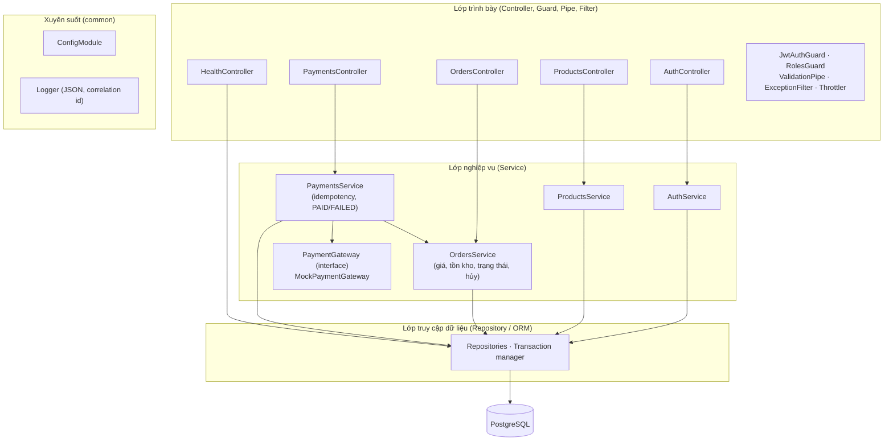

# BrewLite – Mô tả kiến trúc hệ thống (Task 3.1)

| Thông tin | Nội dung |
|---|---|
| Tệp | `docs/architecture/architecture.md` |
| ADR liên quan | `docs/architecture/adr/001` → `008` |
| Đầu vào | `docs/requirements/context-and-scope.md`, `srs.md`, `use-case-checkout.md`, `docs/diagrams/*` |
| Đầu ra cho | Task 3.2 (Deployment diagram), Task 4 (cấu trúc repo, CI), Task 5 (CD, deploy) |

> **Quy ước truy vết:** mỗi thành phần có một mã `COMP-xx`. Deployment diagram (Task 3.2) phải dùng đúng các mã này. Bảng đầy đủ ở mục 4.

---

## 1. Phương pháp trình bày

Kiến trúc được mô tả theo **C4 model** (mức 1 – Context, mức 2 – Container, mức 3 – Component của API) và **kiến trúc phân lớp (Layered Architecture)** cho backend. Phía backend là **modular monolith**: một ứng dụng NestJS duy nhất, chia module theo domain (xem ADR-002).

## 2. C4 mức 1 – System Context

Không có hệ thống bên ngoài nào xử lý tiền thật: Mock Payment nằm trong ranh giới BrewLite (theo `context-and-scope.md` mục 3.5 và `srs.md` mục 5).

## 3. C4 mức 2 – Container

| Container | Vai trò |
|---|---|
| **COMP-WEB** | Giao diện: menu, chi tiết, giỏ hàng, đăng nhập, đặt đơn, thanh toán, theo dõi/lịch sử đơn, màn hình nhân viên. Giỏ hàng giữ ở phía client; mọi giá và tồn kho do API quyết định. |
| **COMP-API** | Toàn bộ nghiệp vụ, xác thực JWT, phân quyền, validate, transaction, Mock Payment, logging, health. |
| **COMP-DB** | Lưu user, sản phẩm, đơn, thanh toán, khóa idempotency. |

### 3.1 Thiết kế frontend (COMP-WEB: Next.js, mobile-first/PWA)

| Chủ đề | Thiết kế | Yêu cầu |
|---|---|---|
| Framework | Next.js (App Router) + TypeScript, chạy dạng container Node (SSR/SSG) | Bắt buộc theo đề bài |
| Mobile-first | CSS thiết kế cho viewport 360×800 và 390×844 trước, mở rộng lên màn lớn; không cuộn ngang; input có nhãn; thao tác được bằng bàn phím | NFR-05 |
| Màn hình | Menu, chi tiết sản phẩm (size/topping), giỏ hàng, đăng ký/đăng nhập, xác nhận đơn, thanh toán, lịch sử đơn, trang nhân viên/quản lý xử lý đơn | FR-01…04, 07, 09, 11…13 |
| Trạng thái giao diện | Mọi màn hình gọi API đều có loading, rỗng, lỗi kèm nút thử lại | FR-01, FR-14 |
| Quản lý giỏ hàng | Giữ **phía client** (state + `localStorage`), phân vùng theo subject của JWT; đăng xuất chuyển sang giỏ khách rỗng và đăng nhập lại cùng tài khoản khôi phục giỏ. Chỉ gửi API khi đặt đơn; API tính lại giá và kiểm tra tồn kho, không tin giá từ client | FR-03, 04, 07 |
| Gọi API | Một lớp API client dùng `NEXT_PUBLIC_API_URL`; gắn `Authorization: Bearer <JWT>`; sinh `Idempotency-Key` cho đặt đơn và thanh toán; hiển thị lỗi theo mã HTTP (401, 400, 409, 429) | FR-06, FR-10, NFR-03 |
| Phân quyền giao diện | Route cho khách cần đăng nhập; trang nhân viên ẩn với khách. Đây chỉ là tiện ích giao diện, quyền thật do API kiểm tra | FR-13 |
| Validate | Validate ở form để báo lỗi sớm; backend vẫn validate lại | FR-14 |
| PWA | **Must:** có `manifest` và chạy tốt trên trình duyệt di động. **Could (mở rộng):** Service Worker cache menu để xem khi offline, có nhãn dữ liệu offline; đặt đơn/thanh toán luôn cần mạng | NFR-05; NFR-10 (Could) |
| Cập nhật trạng thái đơn | Mặc định khách mở lại trang hoặc bấm "Làm mới"; tự động cập nhật (polling) là mở rộng | FR-11, FR-19 (Could) |
| Build/đóng gói | `Dockerfile` multi-stage trong `apps/web`; biến `NEXT_PUBLIC_*` được nhúng lúc build, nên **đổi URL API phải build lại image** | NFR-06, NFR-09 |

## 4. Bảng thành phần (đầu vào cho Deployment Diagram)

| Mã | Thành phần | Công nghệ | Thư mục mã nguồn | Chạy ở đâu | Cổng / giao thức | Phụ thuộc | Yêu cầu liên quan |
|---|---|---|---|---|---|---|---|
| COMP-BROWSER | Trình duyệt / PWA của người dùng | Chrome, Firefox, Service Worker (mở rộng) | — (do `apps/web` tạo ra) | Thiết bị người dùng | HTTPS 443 ra ngoài | COMP-WEB, COMP-API | NFR-05, NFR-10 |
| COMP-WEB | Frontend | Next.js, React, TypeScript | `apps/web/` | Dịch vụ web/container Next.js (kèm CDN của nền tảng) | 3000 trong container; HTTPS 443 ngoài | COMP-API | FR-01…04, FR-11, FR-12, NFR-05 |
| COMP-API | Backend | NestJS, TypeScript | `apps/api/` | Container NestJS | 3001 trong container; HTTPS 443 ngoài | COMP-DB | FR-02…14, NFR-01, 03, 04, 08 |
| COMP-PAY | Mock Payment (module trong API) | NestJS module + interface `PaymentGateway` | `apps/api/src/payments/gateway/` | **Cùng tiến trình với COMP-API**, không có container riêng (ADR-004) | Gọi hàm nội bộ | — | FR-09, FR-10, BR-04 |
| COMP-DB | Cơ sở dữ liệu | PostgreSQL 16 | `apps/api/migrations/`, `apps/api/seed/` | Dịch vụ Postgres do nền tảng quản lý hoặc container có persistent volume | 5432, **chỉ mạng nội bộ** | — | NFR-04, NFR-06 |
| COMP-REG | Container registry | GitHub Container Registry (GHCR), đề xuất | — | Dịch vụ ngoài | HTTPS 443 | — | NFR-09 |
| COMP-CI | CI | GitHub Actions | `.github/workflows/ci.yml` | GitHub runner | HTTPS | — | NFR-07 |
| COMP-CD | CD | GitHub Actions | `.github/workflows/cd.yml` | GitHub runner | HTTPS | COMP-REG, nền tảng triển khai | NFR-09 |
| COMP-PLATFORM | Nền tảng triển khai | **Local Docker Compose** (ADR-006) | `docker-compose.yml`, `docs/deployment.md` | Môi trường local (máy) của nhóm, chạy 3 container web, api, db | web 3000, api 3001 publish ra máy chủ; db 5432 **không publish** | COMP-REG | NFR-02, NFR-04, NFR-06 |
| COMP-LOCAL | Môi trường local | Docker Compose | `docker-compose.yml` | Máy lập trình viên | web 3000, api 3001, db 5432 | — | NFR-06 |

## 5. C4 mức 3 – Component của COMP-API (kiến trúc phân lớp)

### 5.1 Module và trách nhiệm

> Endpoint `POST /orders` và `POST /orders/{id}/payments` đã dùng trong sequence diagram (Task 2.2). Các endpoint còn lại là **đề xuất thiết kế**, sẽ được cố định ở Task 4/5 và cập nhật vào ma trận truy vết.

| Module NestJS | Trách nhiệm | Endpoint chính | Bảng dữ liệu (theo class diagram) |
|---|---|---|---|
| `auth` | Đăng ký, đăng nhập, phát/kiểm JWT, giới hạn đăng nhập sai | `POST /auth/register`, `POST /auth/login` | `User` |
| `products` | Menu, chi tiết, size, topping | `GET /products`, `GET /products/:id` | `Product`, `ProductSize`, `Topping` |
| `orders` | Tạo đơn, tính giá phía server, trừ/hoàn tồn kho, lịch sử, cập nhật trạng thái | `POST /orders`, `GET /orders`, `GET /orders/:id`, `PATCH /orders/:id/status` | `Order`, `OrderItem` |
| `payments` | Thanh toán Ví/Thẻ mô phỏng, chống trùng bằng idempotency key | `POST /orders/:id/payments` | `Payment` |
| `payments/gateway` (COMP-PAY) | Mô phỏng cổng: kịch bản thành công/thất bại/timeout | (gọi nội bộ) | — |
| `health` | Kiểm tra API và DB | `GET /health` | — |
| `common` | Config, logger, filter lỗi, guard, pipe | — | — |
| `promotions`, `loyalty` (mở rộng) | FR-15, FR-16 | — | `Promotion`, `LoyaltyTransaction` |

### 5.2 Quy tắc phụ thuộc giữa các lớp

- Controller chỉ gọi Service, không truy cập DB trực tiếp.
- Service chứa toàn bộ quy tắc nghiệp vụ (BR-01 → BR-05) và quyết định transaction.
- Service phụ thuộc interface `PaymentGateway`, không phụ thuộc cài đặt mock, nên thay cổng thật (FR-20, ngoài phạm vi) không ảnh hưởng nghiệp vụ.
- Module chỉ gọi module khác qua Service được export.

## 6. Dữ liệu và migration

- **PostgreSQL 16**, mô hình dữ liệu bám `docs/diagrams/class-diagram.puml`.
- **Migration** bằng migration của ORM (xem ADR-003), file nằm trong `apps/api/migrations/`, chạy tuần tự, có thể chạy từ DB rỗng.
- **Seed** nằm trong `apps/api/seed/`, **idempotent** (chạy lại không nhân đôi dữ liệu, theo NFR-06).
- Production: migration chạy như **một bước riêng trước khi khởi động phiên bản mới**, theo hướng tương thích ngược để rollback ứng dụng không phải rollback schema.
- Tiền lưu số nguyên VND (BR-01).
- Tạo đơn và trừ tồn kho trong **một transaction** (FR-08); các lệnh cạnh tranh tồn kho dùng khóa dòng (`SELECT … FOR UPDATE`) hoặc cập nhật có điều kiện.
- Idempotency: ràng buộc `UNIQUE` trên khóa idempotency của đơn (theo người dùng) và của thanh toán (BR-05, FR-10).

## 7. Dịch vụ thanh toán mô phỏng (COMP-PAY)

- Là module trong COMP-API, cài đặt interface `PaymentGateway { charge(orderId, amount, method, idempotencyKey) }`.
- Cho phép cấu hình kịch bản qua biến môi trường hoặc quy ước đầu vào (thành công, thất bại, chậm/timeout) để kiểm thử FR-09, FR-10, BR-04.
- Không nhận, không lưu dữ liệu thẻ thật.
- Lý do không tách container riêng: xem ADR-004.

## 8. Logging, health check và cấu hình

| Chủ đề | Thiết kế | Yêu cầu |
|---|---|---|
| **Logging** | Log JSON ra stdout (`nestjs-pino` hoặc tương đương), gồm thời gian, mức, `requestId` (header `x-request-id`, sinh nếu thiếu), `orderCode`/`transactionId` ở sự kiện đơn/thanh toán. Che trường nhạy cảm (`password`, `authorization`, thông tin thẻ). Nền tảng thu log từ stdout. | NFR-08, NFR-04 |
| **Health check** | `GET /health` thực hiện `SELECT 1`; trả **200** khi API và DB sẵn sàng, **503** khi mất DB; không trả secret hay chuỗi kết nối. Dùng cho health check của nền tảng và smoke test của CD. | NFR-02, NFR-09 |
| **Cấu hình** | 12-factor: toàn bộ cấu hình qua **biến môi trường**, đọc bằng `ConfigModule` và validate khi khởi động (thiếu biến thì không chạy). `.env.example` chỉ chứa placeholder. Secret production lưu ở secret store của nền tảng và GitHub Secrets. | NFR-04, NFR-06 |

Biến môi trường dự kiến:

| Biến | Dùng ở | Là secret? | Ghi chú |
|---|---|---|---|
| `NODE_ENV` | web, api | Không | `development` / `production` |
| `PORT` | api | Không | Mặc định 3001 |
| `DATABASE_URL` | api | **Có** | Chuỗi kết nối Postgres |
| `JWT_SECRET` | api | **Có** | Ký JWT |
| `JWT_EXPIRES_IN` | api | Không | `60m` (NFR-03) |
| `CORS_ORIGIN` | api | Không | URL frontend |
| `LOG_LEVEL` | api | Không | `info` |
| `PAYMENT_MOCK_SCENARIO` | api | Không | Kịch bản mô phỏng |
| `NEXT_PUBLIC_API_URL` | web | Không | URL API (lộ ra trình duyệt, không đặt secret) |
| `POSTGRES_USER/PASSWORD/DB` | local compose | Có (local) | Chỉ dùng cho Docker Compose |

## 9. Bảo mật

- HTTPS: đề bài yêu cầu truy cập production qua HTTPS. Với Docker Compose, TLS cần reverse proxy hoặc tunnel đặt trước `web`/`api`; **chưa chọn**, xem ADR-006 và mục 13.
- JWT ngắn hạn (tối đa 60 phút), mật khẩu băm bcrypt, `RolesGuard` cho CUSTOMER / STAFF / MANAGER.
- `ValidationPipe` với whitelist, từ chối trường lạ (ví dụ `role` khi đăng ký).
- `Throttler`: 5 lần đăng nhập sai / 60 giây / cặp email-IP → HTTP 429.
- Giá, tổng tiền, tồn kho luôn tính ở server, không tin dữ liệu từ client.
- Chỉ COMP-API kết nối được COMP-DB; DB không có địa chỉ public.
- Lỗi trả về không kèm stack trace hay chuỗi kết nối.

## 10. Ranh giới môi trường

| Môi trường | Thành phần | Mục đích |
|---|---|---|
| **Local** (COMP-LOCAL) | `docker-compose.yml`: web, api, db + volume | Phát triển, kiểm thử, người ngoài nhóm chạy theo README |
| **CI** (COMP-CI) | GitHub Actions: install → lint → unit test → build; integration test có Postgres service container | Chặn merge khi lỗi (NFR-07) |
| **Registry / CD** (COMP-REG, COMP-CD) | Build image, gắn tag commit SHA hoặc semver, push, deploy, migration, smoke test | Phát hành (NFR-09) |
| **Vận hành cốt lõi** (COMP-PLATFORM = Local Docker Compose) | COMP-WEB, COMP-API, COMP-DB, file `.env`, log, health check | Phục vụ demo/nghiệm thu; truy cập công khai qua HTTPS cần bổ sung (mục 13) |

## 11. Lý do chọn kiến trúc, ưu điểm, hạn chế, trade-off

**Lựa chọn:** modular monolith phân lớp (NestJS) + frontend Next.js tách riêng + một PostgreSQL, đóng gói Docker, monorepo.

| Ưu điểm | Hạn chế | Trade-off đã chấp nhận |
|---|---|---|
| Đơn giản để dựng, deploy và debug với nhóm sinh viên và thời gian một học kỳ | Mọi module scale cùng nhau, một lỗi nghiêm trọng có thể làm sập cả API | Chấp nhận vì tải demo nhỏ; ưu tiên tốc độ giao hàng hơn khả năng scale độc lập |
| Transaction ACID cho tạo đơn + trừ kho ngay trong một DB (FR-08) | Gắn chặt vào một DB; đổi sang vi dịch vụ sau này tốn công | Chấp nhận; ranh giới module rõ giúp tách dần nếu cần |
| Ranh giới module/domain rõ, dễ phân công và viết test | Cần kỷ luật để không gọi chéo module bừa bãi | Quy tắc phụ thuộc ở mục 5.2, review PR kiểm tra |
| Mock Payment sau interface, dễ thay bằng cổng thật | Mock chung process nên không phản ánh độ trễ/lỗi mạng thật | Mô phỏng thêm kịch bản timeout/chậm để kiểm thử BR-04 |
| Frontend/backend tách riêng, triển khai và build độc lập | Phải cấu hình CORS, hai URL, hai image | Chấp nhận; hai container đúng yêu cầu đề bài |
| Một monorepo: tài liệu, code, CI đồng bộ, dễ truy vết | CI chạy cả repo, dễ chậm khi lớn | Dùng path filter trong workflow nếu cần |
| Cấu hình 12-factor, không đưa secret vào repo | Cấu hình sai biến môi trường chỉ lộ khi chạy | Validate cấu hình lúc khởi động |

Các phương án đã cân nhắc và không chọn (vi dịch vụ, Next.js full-stack API Routes, serverless) được ghi trong ADR-002.

## 12. Truy vết kiến trúc ↔ yêu cầu

| Quyết định / Thành phần | ADR | Yêu cầu liên quan |
|---|---|---|
| Monorepo | ADR-001 | Cấu trúc repo của đề bài, NFR-07, NFR-09 |
| Modular monolith phân lớp | ADR-002 | FR-08, NFR-01, NFR-07 |
| PostgreSQL + migration + seed | ADR-003 | NFR-04, NFR-06, FR-08, FR-10 |
| Mock Payment trong API | ADR-004 | FR-09, FR-10, FR-20 (Won't), BR-04 |
| JWT + phân quyền | ADR-005 | FR-05, FR-06, FR-13, NFR-03 |
| Frontend Next.js, mobile-first/PWA, giỏ hàng phía client | ADR-008 | FR-01…04, NFR-05, NFR-10 |
| Docker, CI/CD, nền tảng triển khai | ADR-006 | NFR-06, NFR-07, NFR-09, NFR-02, NFR-04 |
| Logging, health, cấu hình | ADR-007 | NFR-02, NFR-04, NFR-08 |

## 13. Vấn đề nhóm cần chốt (ảnh hưởng Task 3.2)

| # | Nội dung | Giá trị đang đề xuất | Người chốt |
|---|---|---|---|
| 1 | Nền tảng triển khai (ADR-006) | **Đã chốt: Local Docker Compose.** Còn mở: cách có HTTPS công khai (reverse proxy trên VPS hoặc tunnel) để đáp ứng URL production của đề bài | Cả nhóm |
| 2 | ORM và công cụ migration (ADR-003) | TypeORM migrations | Backend |
| 3 | Container registry (ADR-006) | GHCR | DevOps |
| 4 | Frontend chạy dạng nào | Container Node (SSR) trong Compose (đã khớp nền tảng) | Frontend + DevOps |
