# BrewLite – Mô tả kiến trúc triển khai (Task 3.2)

| Thông tin | Nội dung |
|---|---|
| Sơ đồ | Nguồn draw.io: [`deployment-diagram.drawio`](../diagrams/deployment-diagram.drawio) · ảnh xuất: `deployment-diagram.svg` / `.png` (draw.io: File → Export as) |
| Nền tảng | **Local Docker Compose**, vận hành trên máy local của nhóm, không dùng nền tảng cloud (ADR-006) |
| Đầu vào | `architecture.md` mục 3, 4, 6–10; ADR-002, 003, 004, 005, 006, 007 |
| Trạng thái | Mô tả **thiết kế**. Mã nguồn, Dockerfile, Compose và workflow sẽ hiện thực ở Task 4 và 5; chỗ nào là dự kiến đều ghi rõ |
| Ghi chú tên tệp | Tệp này mô tả sơ đồ triển khai. `docs/deployment.md` (hướng dẫn chạy, deploy, rollback theo mục 7.4 đề bài) là tệp khác, viết ở Task 5. |

> Sau khi chỉnh sửa trong draw.io, xuất lại `deployment-diagram.svg` (và `.png`) vào `docs/diagrams/` rồi commit cùng file `.drawio`.

## 1. Tổng quan

BrewLite được triển khai dưới dạng **ba container** (`brewlite-web`, `brewlite-api`, `brewlite-db`) do Docker Compose quản lý trên một máy duy nhất (Local Host Machine). Hệ thống chia thành các phân vùng mạng với mức tin cậy khác nhau:

| Phân vùng | Mức tiếp xúc | Thành phần |
|---|---|---|
| **Z1 – Vùng client** | Ngoài hệ thống, không tin cậy | Thiết bị người dùng, trình duyệt/PWA (COMP-BROWSER) |
| **Z2 – Vùng biên (tùy chọn)** | Cầu nối ra Internet khi cần HTTPS công khai | Tunnel / reverse proxy HTTPS |
| **Z3 – Vùng host** | Máy chủ Docker, nơi cổng được publish | Docker Engine, `docker-compose.yml`, `.env`, cổng 3000 và 3001 |
| **Z4 – Vùng mạng nội bộ Docker** | Tin cậy, chỉ container truy cập | Mạng bridge `brewlite-net`: web, api, Mock Payment |
| **Z5 – Vùng dữ liệu** | Cô lập cao nhất | `brewlite-db`, volume `pgdata`, cổng 5432 |
| **Z6 – Vùng CI/CD** | Ngoài máy host, chỉ nhận mã và image | GitHub (CI, CD, GHCR) |

## 2. Bảng các luồng kết nối (khớp số trên sơ đồ)

| Số | Từ → Đến | Giao thức / cổng | Phân vùng | Mục đích |
|---|---|---|---|---|
| [1] | Trình duyệt → `brewlite-web` | HTTP `:3000` | Z1 → Z3 | Tải giao diện Next.js, tài nguyên PWA |
| [2] | Trình duyệt → `brewlite-api` | HTTP `:3001` + JWT, REST/JSON | Z1 → Z3 | Gọi nghiệp vụ: menu, đặt đơn, thanh toán |
| [3] | `brewlite-web` → `brewlite-api` | HTTP `api:3001` | Z4 (nội bộ) | Gọi API từ phía server (SSR), nếu frontend dùng SSR |
| [4] | `brewlite-api` → `brewlite-db` | TCP/IP `5432` | Z4 → Z5 | Truy vấn, transaction PostgreSQL |
| [5] | `brewlite-api` → COMP-PAY | Gọi hàm nội bộ | Cùng tiến trình | Mock Payment qua interface `PaymentGateway` |
| [6] | `brewlite-db` → volume `pgdata` | Mount thư mục dữ liệu | Z5 | Lưu bền vững khi khởi động lại container |
| [7] | Trình duyệt → tunnel | HTTPS `443` | Z1 → Z2 | **Tùy chọn**: truy cập HTTPS công khai |
| [8] | Tunnel → `brewlite-web` | HTTP `localhost:3000` | Z2 → Z3 | **Tùy chọn**: chuyển tiếp vào frontend |
| [9] | CI → CD | Sự kiện push/tag | Z6 | Kích hoạt pipeline phát hành |
| [10] | CD → GHCR | HTTPS `443` | Z6 | Đẩy image gắn tag SHA hoặc `vX.Y.Z` |
| [11] | CD → `brewlite-api` | `GET /health` | Z6 → Z3 | Deploy và smoke test (cần self-hosted runner hoặc chạy tay) |
| [12] | Host → GHCR | HTTPS `443` | Z3 → Z6 | `docker compose pull` kéo image về |

Hai mũi tên nét đứt xám không đánh số là cấu hình: `.env` → container (`env_file`) và `docker-compose.yml` → Docker Engine (`docker compose up`).

## 3. Mô tả chi tiết từng phân vùng mạng

### Z1 – Vùng client (thiết bị người dùng)

- **Thành phần:** trình duyệt Chrome/Firefox chạy ứng dụng Next.js mobile-first/PWA (COMP-BROWSER). Thiết bị có thể là điện thoại khách hoặc máy chấm điểm của giảng viên.
- **Cơ chế:** trình duyệt nằm **ngoài** mạng Docker nên không phân giải được tên dịch vụ nội bộ (`web`, `api`, `db`). Nó chỉ tiếp cận được hệ thống qua địa chỉ và cổng mà host publish ([1], [2]) hoặc qua tunnel ([7]).
- **Kiểm soát:** vùng này **không được tin cậy**. Mọi dữ liệu từ client (giá, tổng tiền, vai trò) đều bị API kiểm tra lại; xác thực bằng JWT ngắn hạn (tối đa 60 phút), phân quyền theo vai trò CUSTOMER/STAFF/MANAGER (ADR-005, NFR-03).
- **Lưu ý khi truy cập:** `localhost` trên điện thoại chỉ chính điện thoại đó. Thiết bị khác máy host phải dùng địa chỉ mạng của máy host hoặc URL của tunnel.

### Z2 – Vùng biên: tunnel / reverse proxy HTTPS (tùy chọn)

- **Mục đích:** đáp ứng yêu cầu HTTPS của đề bài (mục 7.4) khi demo hoặc nghiệm thu cần truy cập công khai. Mặc định hệ thống chạy qua cổng nội bộ `http://localhost:3000`.
- **Cơ chế:** tunnel (Cloudflare Tunnel) hoặc reverse proxy đặt **ngoài mạng Docker**. Nó kết thúc TLS ở cổng 443 rồi chuyển tiếp HTTP vào `localhost:3000` ([7] → [8]). Với tunnel, kết nối do máy host chủ động tạo ra phía ngoài nên không cần mở cổng vào trên máy host.
- **Kiểm soát:** chỉ trỏ vào frontend; **không bao giờ** trỏ vào `brewlite-db`. Phạm vi cuối cùng (có bọc thêm API hay không) do nhóm chốt ở Task 4–5.
- **Trạng thái:** tùy chọn, chỉ bật khi cần. Khi không bật, vùng này không tồn tại.

### Z3 – Vùng host (Local Host Machine)

- **Thành phần:** máy laptop phát triển/demo (COMP-PLATFORM = COMP-LOCAL), chạy Docker Engine, giữ `docker-compose.yml` (gốc repo) và `.env`.
- **Cơ chế publish cổng:** cổng của container chỉ truy cập được từ bên ngoài khi được khai báo trong `ports` của Compose. Docker chuyển lưu lượng từ cổng host vào container tương ứng. Thiết kế publish hai cổng: `3000:3000` (web) và `3001:3001` (api). **`db` không có mục `ports`**, nên không có cổng 5432 nào trên host.
- **Cấu hình và secret:** `.env` nằm trên host, **không commit**; `.env.example` trong repo chỉ có placeholder. Compose nạp biến vào từng container qua `env_file` (`DATABASE_URL`, `JWT_SECRET`, `POSTGRES_*` ...). Biến có tiền tố `NEXT_PUBLIC_` lộ ra trình duyệt nên tuyệt đối không đặt secret (ADR-007).
- **Vận hành:** log ghi ra stdout dạng JSON và đọc bằng `docker compose logs`; health check khai báo trong Compose.
- **Hạn chế:** máy host phải bật trong phiên nghiệm thu; không có tự phục hồi hay cân bằng tải (NFR-02 chỉ là mục tiêu demo).

### Z4 – Vùng mạng nội bộ Docker (`brewlite-net`)

- **Thành phần:** container `brewlite-web` (Next.js, 3000), `brewlite-api` (NestJS, 3001, có module Mock Payment).
- **Cơ chế:** Compose tạo một mạng **bridge** riêng. Các container trong mạng gọi nhau bằng **tên dịch vụ** thông qua DNS nội bộ của Docker (ví dụ `api:3001`), không cần biết địa chỉ IP. Lưu lượng [3] và [4] đi hoàn toàn trong mạng này và không đi qua cổng publish của host.
- **Kiểm soát:**
  - Chỉ `brewlite-api` mở kết nối tới `brewlite-db` (`DATABASE_URL`); web không truy cập DB trực tiếp.
  - API áp dụng `ValidationPipe` (whitelist), `RolesGuard`, giới hạn đăng nhập (5 lần/60 giây → HTTP 429) và không trả stack trace hay chuỗi kết nối.
- **Mock Payment (COMP-PAY):** là module chạy **cùng tiến trình** với API (ADR-004). Việc gọi là gọi hàm [5], không có kết nối mạng, không có cổng riêng, không nhận hay lưu dữ liệu thẻ thật.

### Z5 – Vùng dữ liệu (`brewlite-db` và volume)

- **Thành phần:** PostgreSQL 16 (COMP-DB) cổng 5432 và named volume `pgdata`.
- **Cơ chế cô lập:** cổng 5432 chỉ tồn tại **bên trong** `brewlite-net` ([4]). Vì Compose không publish cổng này, không thể kết nối tới DB từ máy khác hay từ Internet (NFR-04). Sơ đồ không vẽ bất kỳ đường nào từ DB ra ngoài.
- **Bền vững dữ liệu:** thư mục dữ liệu của PostgreSQL được mount vào volume `pgdata` ([6]). Container có thể bị xóa hoặc khởi động lại mà dữ liệu vẫn còn (NFR-06).
- **Tính toàn vẹn:** tạo đơn và trừ tồn kho chạy trong một transaction; migration chạy từ DB rỗng; seed idempotent (`architecture.md` mục 6).
- **Health:** `pg_isready` kiểm tra DB sẵn sàng; `GET /health` của API chạy `SELECT 1` và trả 503 khi mất DB.
- **Ghi chú vận hành (dự kiến):** nếu thành viên cần mở DB bằng công cụ ngoài, dùng file Compose override riêng chỉ bind `127.0.0.1`, không đưa vào Compose chính.

### Z6 – Vùng CI/CD (GitHub)

- **Thành phần:** COMP-CI (`ci.yml`: Install → Lint → Unit Test → Build, chặn merge nếu lỗi), COMP-CD (`cd.yml`: build image → push → deploy → migration → smoke test), COMP-REG (GHCR, lưu image gắn tag).
- **Cơ chế:** vùng này **không chạy ứng dụng**. Nó nhận mã nguồn, kiểm tra chất lượng, đóng gói image rồi đẩy lên registry ([9], [10]). Máy host kéo image về bằng `docker compose pull` ([12]).
- **Deploy về máy local:** runner do GitHub cung cấp không truy cập được máy local, nên bước deploy ([11]) dùng **self-hosted runner** hoặc chạy tay theo `docs/deployment.md` và ghi lại kết quả. Smoke test gọi `GET /health` và trang menu; nếu lỗi thì dừng pipeline.
- **Rollback:** đổi biến tag image về bản đã biết hoạt động rồi `docker compose up -d`; giới hạn rollback dữ liệu nêu ở `docs/deployment.md`.
- **Secret:** GitHub Secrets chỉ dùng cho workflow; không in ra log CI.

## 4. Ví dụ luồng xử lý: đặt đơn và thanh toán

1. Khách tải giao diện từ `brewlite-web` ([1]); trình duyệt gọi API ([2]) kèm JWT.
2. `brewlite-api` xác thực JWT, kiểm tra dữ liệu, tính giá và tồn kho ở phía server.
3. API mở transaction tới `brewlite-db` ([4]): tạo đơn, các dòng đơn, trừ tồn kho, rồi commit hoặc rollback toàn bộ.
4. Khi thanh toán, API gọi COMP-PAY bằng hàm nội bộ ([5]) cùng khóa idempotency; kết quả được ghi vào DB ([4]) và trả về trình duyệt ([2]).
5. Dữ liệu được ghi xuống volume `pgdata` ([6]), nên vẫn còn sau khi container khởi động lại.

Chi tiết từng bước nằm ở `docs/diagrams/sequence-checkout.puml`.

## 5. Khởi động và kiểm tra sức khỏe (thiết kế dự kiến)

- `db` khởi động trước, `healthcheck` dùng `pg_isready`.
- `api` chờ `db` sẵn sàng; migration chạy như bước riêng trước khi `api` nhận request; sau đó `GET /health` trả 200.
- `web` khởi động sau cùng và phục vụ trang menu.
- Smoke test của CD kiểm tra `GET /health` và trang menu sau mỗi lần triển khai.

## 6. Các biện pháp bảo mật theo phân vùng

| Phân vùng | Biện pháp | Yêu cầu |
|---|---|---|
| Z1 | Không tin dữ liệu client; JWT ≤ 60 phút; RolesGuard | NFR-03, FR-06 |
| Z2 | TLS tại biên (nếu bật); không trỏ vào DB | NFR-04 |
| Z3 | `.env` không commit; chỉ publish cổng cần thiết | NFR-04, NFR-06 |
| Z4 | Mạng bridge riêng; chỉ api truy cập DB; validate dữ liệu; không lộ stack trace | NFR-03, NFR-04, FR-14 |
| Z5 | Không publish 5432; volume bền vững; transaction | NFR-04, NFR-06, FR-08 |
| Z6 | GitHub Secrets; PR không merge khi CI lỗi | NFR-07, NFR-09 |

## 7. Truy vết sơ đồ ↔ kiến trúc ↔ mã nguồn

| Thành phần | Mục `architecture.md` | ADR | Mã nguồn / tệp (dự kiến) |
|---|---|---|---|
| COMP-BROWSER | 3, 4 | ADR-008 | sinh ra từ `apps/web/` |
| COMP-WEB | 3, 3.1, 4 | ADR-002, 008 | `apps/web/`, `apps/web/Dockerfile` |
| COMP-API | 4, 5, 8 | ADR-002, 005, 007 | `apps/api/`, `apps/api/Dockerfile` |
| COMP-PAY | 7 | ADR-004 | `apps/api/src/payments/gateway/` |
| COMP-DB, volume `pgdata` | 6 | ADR-003 | `apps/api/migrations/`, `apps/api/seed/` |
| COMP-PLATFORM, COMP-LOCAL | 4, 10 | ADR-006 | `docker-compose.yml`, `.env.example` |
| COMP-CI, COMP-CD, COMP-REG | 10 | ADR-006 | `.github/workflows/ci.yml`, `cd.yml` |
