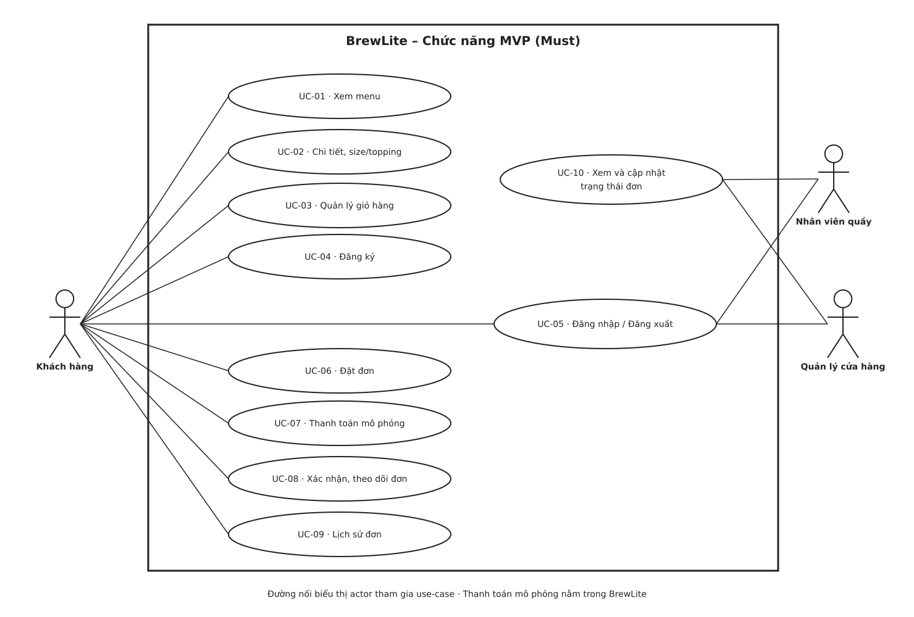
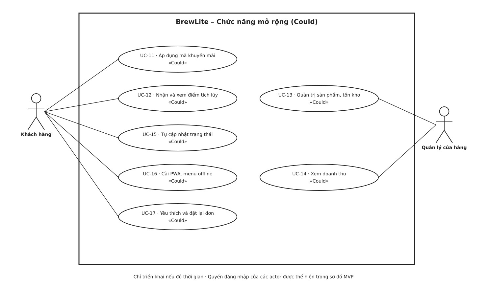

# BrewLite – SRS Task 1.2

## 1. Mục đích và phạm vi

BrewLite hỗ trợ một cửa hàng đồ uống, với luồng: **Xem menu → Chọn tùy chọn → Giỏ hàng → Đặt đơn → Thanh toán → Theo dõi đơn**. Khách nhận món tại quầy. Giao diện tiếng Việt, tiền tệ VND; Next.js mobile-first/PWA, NestJS và PostgreSQL là công nghệ bắt buộc. Thanh toán Ví/Thẻ được mô phỏng, không dùng dữ liệu thẻ hoặc tiền thật.

## 2. Actor, thuật ngữ và mức ưu tiên

| Actor | Quyền trong MVP |
|---|---|
| Khách hàng | Xem menu và chi tiết khi chưa đăng nhập; sau đăng nhập có thể đặt, thanh toán và xem đơn của mình |
| Nhân viên quầy | Dùng tài khoản cấp sẵn để xem danh sách đơn cửa hàng và cập nhật trạng thái cho phép |
| Quản lý cửa hàng | Có các quyền xử lý đơn của nhân viên; tính năng quản trị menu/doanh thu thuộc mở rộng |

Dịch vụ thanh toán mô phỏng nằm trong ranh giới BrewLite.

| Mức MoSCoW | Ý nghĩa |
|---|---|
| Must | Bắt buộc để nghiệm thu MVP sau Sprint 2; menu thuộc Sprint 1 |
| Should | Nên có nếu đã hoàn thành Must |
| Could | Mở rộng khi còn thời gian, chưa cam kết trong MVP |
| Won’t | Không thực hiện trong đợt bàn giao này |

FR: yêu cầu chức năng. NFR: yêu cầu phi chức năng. Các tiêu chí dưới đây là điều kiện nghiệm thu khi triển khai.

## 3. Yêu cầu chức năng

| Mã | Yêu cầu | Ưu tiên | Tiêu chí chấp nhận có thể kiểm chứng |
|---|---|---|---|
| FR-01 | Xem menu theo danh mục, hiển thị hình ảnh, tên, giá cơ bản và tình trạng còn/hết hàng | Must | Không đăng nhập vẫn xem được menu từ dữ liệu seed với hình ảnh, tên và giá từng sản phẩm; chọn danh mục chỉ hiện sản phẩm thuộc danh mục đó; có giao diện loading, danh sách rỗng và lỗi tải kèm nút thử lại. |
| FR-02 | Xem chi tiết và chọn size/topping hợp lệ | Must | Mở một sản phẩm thấy mô tả, giá, size S/M/L và topping được hỗ trợ cho món; thay đổi tùy chọn cập nhật đơn giá; máy chủ từ chối mã sản phẩm/size/topping không hợp lệ hoặc không áp dụng cho món. |
| FR-03 | Thêm món vào giỏ hàng | Must | Chọn một món, size/topping và số lượng nguyên dương rồi thêm; giỏ lưu đúng cấu hình và số lượng; từ chối số lượng 0, âm hoặc thập phân. |
| FR-04 | Sửa, xóa món và tính tổng giỏ hàng | Must | Sửa số lượng làm tổng tiền thay đổi tương ứng; xóa dòng cuối hiện giỏ rỗng; với đơn giá 30.000 và 40.000, số lượng 2 và 1, tổng là 100.000 VND; giỏ rỗng không được đặt đơn; badge giỏ hàng bằng tổng số lượng món. Khi đăng xuất, xóa giỏ hàng của phiên trước để tránh lộ dữ liệu giữa tài khoản. |
| FR-05 | Đăng ký tài khoản khách hàng bằng email/mật khẩu | Must | Email hợp lệ chưa tồn tại tạo tài khoản vai trò khách hàng; email trùng hoặc dữ liệu sai bị từ chối; gửi trường role=manager không tạo được tài khoản quản lý. Quy tắc độ dài mật khẩu theo NFR-03. |
| FR-06 | Đăng nhập, đăng xuất và xác thực JWT | Must | Thông tin đúng tạo phiên JWT; sai trả lỗi chung; JWT thiếu, hết hạn hoặc bị sửa bị từ chối ở chức năng cần xác thực; đăng xuất xóa phiên phía trình duyệt, thao tác tiếp theo yêu cầu đăng nhập. Chưa đăng nhập vẫn xem được menu/giỏ, nhưng phải đăng nhập khi đặt đơn. |
| FR-07 | Tạo đơn từ giỏ và kiểm tra giá/tồn kho ở máy chủ | Must | Với giỏ hợp lệ và tài khoản đã đăng nhập, tạo một đơn ở trạng thái PENDING (Chờ thanh toán), có mã, chủ sở hữu, dòng món và tổng tiền; lưu ảnh chụp tên/giá/tùy chọn tại lúc đặt. Giá gửi từ client bị sửa không được dùng làm giá chốt. Sản phẩm hết hàng hoặc tùy chọn hết hiệu lực khiến yêu cầu thất bại, không tạo đơn dở dang. |
| FR-08 | Giữ tính nhất quán khi tạo đơn và trừ tồn kho | Must | Tạo đơn, các dòng đơn và trừ tồn kho thành công hoặc rollback cùng nhau; với tồn kho 1 và hai yêu cầu đồng thời mỗi yêu cầu mua 1, chỉ một yêu cầu thành công, tồn cuối bằng 0. Lỗi giữa giao dịch không để lại đơn hoặc lượng tồn bị trừ một phần. |
| FR-09 | Thanh toán Ví/Thẻ mô phỏng | Must | Chủ đơn PENDING hoặc PAYMENT_FAILED chọn Ví hoặc Thẻ mô phỏng; kịch bản thành công ghi nhận giao dịch thành công và đưa đơn sang PAID (Đã thanh toán), trừ đúng số lượng đã chốt trên đơn khỏi giỏ một lần, giữ phần thêm sau đó: tạo đơn 2 ly cùng cấu hình rồi thêm 1 ly vào chính dòng cũ, thanh toán xong giỏ còn 1 ly; phát lại kết quả thanh toán không trừ thêm; kịch bản thất bại xác định chuyển đơn sang PAYMENT_FAILED (Thanh toán thất bại), giữ nguyên giỏ hàng, báo lỗi và cho thử lại trên cùng đơn với khóa thanh toán mới; lỗi mạng/timeout hiển thị chưa xác định kết quả, cho tra cứu trước khi thử lại. Không yêu cầu số thẻ thật. Khi chạy đồng thời với yêu cầu hủy, phải đạt BR-03/BR-04. |
| FR-10 | Chống ghi nhận thanh toán trùng | Must | Cùng một đơn và idempotency key, gửi lại hoặc gửi đồng thời trả cùng giao dịch/kết quả, không có hai lần thành công; cùng key nhưng nội dung khác bị từ chối. Đơn đã thanh toán không nhận thêm thanh toán thành công kể cả với key mới. Sau thất bại xác định, thử lại bằng key mới được phép. |
| FR-11 | Xem xác nhận và theo dõi đơn của mình | Must | Sau tạo đơn, khách thấy mã, danh sách món, tổng và trạng thái; sau thanh toán hiển thị đúng kết quả; sau khi nhân viên/quản lý cập nhật trạng thái thành công, khách mở lại trang hoặc nhấn nút “Làm mới” phải thấy trạng thái đã lưu mới nhất. Nếu tải trạng thái thất bại, hiển thị thông báo lỗi và cho thử lại; không báo dữ liệu cũ là trạng thái mới nhất. Dùng mã đơn của khách khác bị từ chối và không lộ chi tiết. Tự cập nhật nền thuộc FR-19. |
| FR-12 | Xem lịch sử và chi tiết đơn đã đặt | Must | Khách đăng nhập thấy chỉ đơn của mình, mới nhất trước; mở đơn thấy món, tùy chọn, giá tại lúc đặt, tổng, trạng thái đơn và thanh toán; tài khoản chưa có đơn hiện trạng thái rỗng; sửa giá menu sau đó không làm đổi tổng đơn cũ. |
| FR-13 | Nhân viên/quản lý xem và cập nhật trạng thái đơn | Must | Tài khoản cấp sẵn thấy đơn cửa hàng và cập nhật đúng bảng chuyển trạng thái ở mục 4; khách hàng không được gọi thao tác cập nhật dù tự gửi request. Đơn chưa thanh toán không được chuyển sang Đang pha chế; chuyển ngược từ Hoàn tất bị từ chối. Kiểm thử hủy đồng thời với thanh toán theo BR-03: không được có cả hủy thành công và thanh toán thành công cho cùng đơn. |
| FR-14 | Validate và báo lỗi nhập liệu | Must | Frontend chỉ ra trường sai và giữ dữ liệu hợp lệ; request bỏ qua frontend vẫn bị backend kiểm tra kiểu dữ liệu, trường bắt buộc, số lượng và quyền sở hữu; lỗi không trả stack trace. |
| FR-15 | Áp dụng mã khuyến mãi | Could | Nếu triển khai: Mã hợp lệ trong thời gian và điều kiện áp dụng được giảm đúng một lần; mã hết hạn/không đủ điều kiện bị từ chối; tổng sau giảm không âm và lưu số giảm trên đơn. Giảm theo phần trăm, giới hạn mức giảm tối đa và không vượt tổng trước giảm; kiểm tra mã có bật, thời hạn, giá trị tối thiểu và số lượt còn lại. Với tổng 100.000 VND, mã 10%, trần 8.000 VND, tổng sau giảm là 92.000 VND. |
| FR-16 | Tích điểm khách hàng | Could | Nếu triển khai: Cộng điểm đúng một lần khi đơn của khách đăng nhập chuyển sang PAID, không chờ Hoàn tất; xử lý lại cùng thanh toán không cộng lần hai. Điểm = floor(tổng sau giảm / 10.000 VND); đơn 95.000 VND cộng 9 điểm, thanh toán thất bại không cộng điểm. Khách xem được số dư điểm của mình; khách khác không được truy cập số dư này. Chưa hỗ trợ đổi điểm. |
| FR-17 | Quản trị sản phẩm và tồn kho | Could | Nếu triển khai: chỉ quản lý tạo/sửa sản phẩm, giá và tồn kho không âm; menu phản ánh dữ liệu mới sau tải lại; nhân viên/khách không có quyền sửa. |
| FR-18 | Xem thống kê doanh thu cơ bản | Could | Nếu triển khai: chỉ quản lý xem báo cáo theo khoảng ngày; bộ dữ liệu kiểm thử cho kết quả bằng tổng đơn Hoàn tất đã thanh toán, không gồm đơn hủy/chưa trả tiền. |
| FR-19 | Tự cập nhật trạng thái đơn | Could | Nếu triển khai: khi nhân viên đổi trạng thái, màn hình khách đang mở nhận trạng thái mới trong tối đa 10 giây trên môi trường local Docker Compose, một khách mở trang và kết nối liên tục, không cần tải lại; khi mất kết nối có thông báo và có thể thử lại. |
| FR-20 | Tích hợp thanh toán thật | Won’t | Bản bàn giao chỉ có Ví/Thẻ mô phỏng, không có luồng thu tiền thật hoặc thu thập dữ liệu thẻ thật. |
| FR-21 | Giao hàng tận nơi | Won’t | Bản bàn giao chỉ nhận tại quầy; không có chọn địa chỉ, tính phí giao hàng hoặc theo dõi tài xế. |
| FR-22 | Yêu thích và đặt lại đơn từ lịch sử | Could | Nếu triển khai: khách đăng nhập đánh dấu/bỏ yêu thích và xem các đơn yêu thích của mình; không xem hoặc thao tác đơn khách khác. Đặt lại một đơn hợp lệ thêm đúng món, size/topping và số lượng vào giỏ, dùng giá và tồn kho hiện tại, không dùng lại mã giảm giá/giao dịch cũ và không tự tạo đơn hay thanh toán. Nếu có món/tùy chọn ngừng bán hoặc không đủ tồn, báo rõ và không thay đổi giỏ; ví dụ giá cũ 30.000, giá hiện tại 35.000 thì 2 ly đặt lại có tổng 70.000 VND trước khuyến mãi. |

## 4. Quy tắc nghiệp vụ

- **BR-01:** đơn giá = giá cơ bản + phụ thu size + tổng giá topping (mỗi loại chọn tối đa một lần); thành tiền = đơn giá × số lượng; tổng trước giảm là tổng thành tiền; nếu áp dụng FR-15 thì tổng thanh toán = tổng trước giảm − số giảm hợp lệ. Phụ thu size: S +0, M +6.000, L +10.000 VND; topping lấy giá máy chủ. Tiền dùng số nguyên VND; số giảm làm tròn tới VND gần nhất (phần lẻ 0,5 làm tròn lên), không có phí giao hàng. Điểm thưởng không tự trừ vào tổng tiền.
- **BR-02:** tồn kho theo sản phẩm, cộng số lượng mọi cấu hình cùng sản phẩm để kiểm tra. Trừ tồn khi tạo đơn thành công, không trừ lần nữa khi thanh toán.
- **BR-03:** nhân viên/quản lý chỉ được hủy đơn PENDING hoặc PAYMENT_FAILED có kết quả thanh toán xác định chưa thành công; hoàn tồn đúng một lần trong cùng giao dịch hủy. Đơn đang có thanh toán chưa rõ kết quả chưa được hủy. MVP không hủy đơn đã thanh toán vì không có hoàn tiền tự động. Kiểm thử cùng đơn bằng hai yêu cầu đồng thời (hủy và thanh toán mô phỏng thành công): nếu thanh toán thắng thì đơn PAID, không hoàn tồn; nếu hủy thắng thì đơn CANCELLED, hoàn đúng lượng đã trừ và thanh toán bị từ chối, không ghi giao dịch SUCCEEDED. Không có kết quả vừa CANCELLED/hoàn tồn vừa SUCCEEDED. Gửi lại yêu cầu hủy không làm hoàn tồn lần hai.
- **BR-04:** timeout không đồng nghĩa thất bại; tra cứu giao dịch hiện có trước khi cho phát sinh lần thử mới. Kết quả lặp lại không đổi đơn đã hủy/hoàn tất hoặc ghi nhận thành công lần hai. Chưa tự hết hạn đơn chưa trả tiền; nhân viên xử lý hủy theo BR-03. Trong lúc giao dịch đang PROCESSING hoặc chưa rõ kết quả, yêu cầu hủy bị từ chối và không hoàn tồn; khi thành công được xác nhận sau timeout, giữ PAID và không hoàn tồn. Không chỉ kiểm tra trạng thái trước khi xử lý: việc chốt hủy/thanh toán phải bảo đảm loại trừ lẫn nhau theo BR-03.
- **BR-05:** các request tạo đơn cùng khách và cùng mã yêu cầu checkout phải trả cùng đơn; dùng lại mã với giỏ khác bị từ chối. Nhấn hai lần hoặc retry sau lỗi mạng không tạo hai đơn/trừ tồn hai lần.

| Trạng thái hiện tại | Trạng thái tiếp theo | Chủ thể / điều kiện |
|---|---|---|
| PENDING – Chờ thanh toán | PAID – Đã thanh toán | Hệ thống, khi thanh toán mô phỏng thành công |
| PENDING – Chờ thanh toán | PAYMENT_FAILED – Thanh toán thất bại | Hệ thống, khi nhận thất bại xác định |
| PAYMENT_FAILED | PAID | Hệ thống, thử lại cùng đơn thành công với khóa mới |
| PAYMENT_FAILED | PAYMENT_FAILED | Thử lại tiếp tục thất bại; ghi một lần thử mới, không trừ tồn lần nữa |
| PENDING hoặc PAYMENT_FAILED | CANCELLED – Hủy | Nhân viên/quản lý, theo BR-03 |
| PAID | PREPARING – Đang pha chế | Nhân viên/quản lý |
| PREPARING | READY – Sẵn sàng | Nhân viên/quản lý |
| READY | COMPLETED – Hoàn tất | Nhân viên/quản lý, khi giao món |
| COMPLETED hoặc CANCELLED | Không chuyển tiếp | Trạng thái kết thúc |

Trạng thái giao dịch thanh toán (PROCESSING/SUCCEEDED/FAILED) được lưu riêng; PAYMENT_FAILED đồng thời phản ánh lần thanh toán thất bại ở mức đơn. Không dùng kết quả thất bại đến muộn để ghi đè giao dịch/đơn đã PAID. Retry thanh toán trên cùng đơn không tạo lại đơn hoặc trừ tồn lần nữa.

## 5. Yêu cầu phi chức năng

| Mã | Yêu cầu | Ưu tiên | Tiêu chí chấp nhận có thể kiểm chứng |
|---|---|---|---|
| NFR-01 | Hiệu năng API | Must | Thời gian phản hồi API < 500 ms với dữ liệu mẫu. Chạy local theo Docker Compose với seed, một người dùng, sau 10 request khởi động cho mỗi endpoint; đo 100 request cho mỗi API nghiệp vụ thuộc luồng nghiệm thu (dùng dữ liệu riêng cho tạo đơn/thanh toán), mỗi request phải < 500 ms. Ghi cấu hình máy, phiên bản seed, endpoint, số mẫu, max và p95; đo từ lúc client gửi request tới khi nhận đủ response. |
| NFR-02 | Khả dụng trong phiên nghiệm thu | Must | Thực hiện 30 lần kiểm tra ở phút 0–29, cách nhau 60 giây: trang menu và health API production trả thành công ít nhất 29/30 lần; ghi nhận cold start và lần lỗi. Health trả 200 khi API và DB sẵn sàng, trả trạng thái không thành công khi mất DB; không trả secret. Đây là mục tiêu demo, chưa cam kết SLA 24/7. |
| NFR-03 | Bảo vệ tài khoản và phân quyền | Must | Mật khẩu được băm bằng bcrypt có salt, không lưu/ghi log bản rõ; kiểm thử JWT giả/hết hạn và truy cập chéo tài khoản đều bị từ chối. Mật khẩu tối thiểu 8 ký tự và tối đa 72 byte UTF-8, từ chối đầu vào vượt giới hạn trước khi băm; token truy cập hết hạn tối đa sau 60 phút. Sau 5 lần đăng nhập sai trong cửa sổ 60 giây của cùng cặp email/IP, các lần tiếp theo bị từ chối với HTTP 429 đến hết cửa sổ; thử lại sau cửa sổ được phép. |
| NFR-04 | Bảo vệ dữ liệu và cấu hình | Must | Production dùng HTTPS; thử kết nối PostgreSQL từ Internet công cộng không được; rà repository và log CI không chứa secret thực, mật khẩu/JWT hoặc dữ liệu thẻ; file cấu hình mẫu chỉ có placeholder. Lỗi API không lộ chuỗi kết nối hoặc stack trace. |
| NFR-05 | Dễ dùng trên điện thoại | Must | Kiểm tra trên Chrome và Firefox bản ổn định tại ngày kiểm thử (ghi phiên bản); viewport 360×800 và 390×844: luồng menu đến xác nhận không cuộn ngang, không che nút chính; input có nhãn, lỗi có chữ giải thích; thao tác chính thực hiện được bằng bàn phím và focus nhìn thấy rõ. |
| NFR-06 | Khả năng triển khai và tái tạo dữ liệu | Must | Trên máy có Docker và cấu hình theo hướng dẫn, chạy compose khởi động web Next.js, API NestJS, PostgreSQL; migration/seed tạo được dữ liệu mẫu từ DB rỗng; chạy seed lại không nhân đôi dữ liệu; dữ liệu đơn còn sau khi restart container với volume được giữ. Production có URL frontend, API và health hoạt động. |
| NFR-07 | Kiểm thử và chất lượng trước triển khai | Must | CI của PR chạy install, lint, unit test và build; bất kỳ bước nào lỗi đều chặn merge. Có unit test nghiệp vụ giá/trạng thái, integration test tạo đơn/thanh toán và ít nhất một E2E menu → xác nhận; các test bao phủ hết hàng, chưa đăng nhập, thanh toán thất bại, retry trùng và hủy đồng thời với thanh toán theo BR-03/BR-04. |
| NFR-08 | Quan sát vận hành | Must | Log có thời gian, mức lỗi và mã tương quan; truy được tạo đơn/thanh toán/cập nhật trạng thái bằng mã đơn/giao dịch; log che dữ liệu nhạy cảm; mô phỏng lỗi DB tạo log lỗi và health không thành công. |
| NFR-09 | Khả năng bàn giao và rollback | Must | Người ngoài nhóm làm theo README chạy local, test, build được; bản phát hành có tag/release notes; CD chạy quality gate, đóng gói có tag SHA/phiên bản, deploy, migration và smoke test; lỗi smoke test làm pipeline thất bại và có hướng dẫn rollback về bản đã biết hoạt động, nêu giới hạn rollback dữ liệu. |
| NFR-10 | PWA nâng cao và menu offline | Could | Nếu triển khai: cài ứng dụng trên trình duyệt hỗ trợ; menu đã cache xem được khi mất mạng và có nhãn dữ liệu offline; đặt đơn/thanh toán yêu cầu kết nối lại, không báo thành công khi chưa có xác nhận máy chủ. |

## 6. Use-case tổng quát và liên kết yêu cầu

**Chức năng MVP (Must)**

**Chức năng mở rộng (Could)**

Hai sơ đồ cùng mô tả hệ thống BrewLite, tách theo mức ưu tiên để dễ đọc. Nguồn chỉnh sửa: [MVP](../diagrams/use-case-overview.drawio) và [mở rộng](../diagrams/use-case-extensions.drawio). Won’t nằm ngoài phạm vi triển khai.

| Use-case | Tên | Actor | FR liên quan |
|---|---|---|---|
| UC-01 | Xem menu | Khách hàng | FR-01 |
| UC-02 | Xem chi tiết, chọn size/topping | Khách hàng | FR-02 |
| UC-03 | Quản lý giỏ hàng | Khách hàng | FR-03, FR-04 |
| UC-04 | Đăng ký | Khách hàng | FR-05 |
| UC-05 | Đăng nhập / đăng xuất | Cả ba actor | FR-06 |
| UC-06 | Đặt đơn | Khách hàng | FR-07, FR-08 |
| UC-07 | Thanh toán mô phỏng | Khách hàng | FR-09, FR-10 |
| UC-08 | Xem xác nhận, theo dõi đơn | Khách hàng | FR-11 |
| UC-09 | Xem lịch sử đơn | Khách hàng | FR-12 |
| UC-10 | Xem và cập nhật trạng thái đơn | Nhân viên quầy, Quản lý | FR-13 |
| UC-11 | Áp dụng mã khuyến mãi (Could) | Khách hàng | FR-15 |
| UC-12 | Nhận và xem điểm tích lũy (Could) | Khách hàng | FR-16 |
| UC-13 | Quản trị sản phẩm, tồn kho (Could) | Quản lý | FR-17 |
| UC-14 | Xem doanh thu (Could) | Quản lý | FR-18 |
| UC-15 | Tự cập nhật trạng thái (Could) | Khách hàng | FR-19 |
| UC-16 | Cài PWA, xem menu offline (Could) | Khách hàng | NFR-10 |
| UC-17 | Yêu thích và đặt lại đơn (Could) | Khách hàng | FR-22 |

FR-14 áp dụng cho mọi use-case nhận đầu vào; NFR áp dụng xuyên suốt. Đặt đơn, thanh toán, xem đơn/điểm và thao tác nhân viên yêu cầu phiên đăng nhập hợp lệ. UC-12 chỉ cộng điểm sau thanh toán thành công; UC-15 bổ sung cho UC-08, không thay thế thao tác làm mới của MVP. UC-16 thể hiện chức năng tùy chọn hỗ trợ NFR-10; các NFR còn lại là ràng buộc chất lượng, không vẽ thành use-case. Sơ đồ mô tả quyền tham gia, không mô tả thứ tự thực hiện. Các actor ở hai sơ đồ là cùng các vai trò; sơ đồ mở rộng không bổ sung quyền ngoài SRS.
