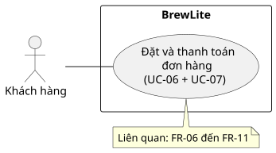

# Đặc tả use-case: Đặt và thanh toán đơn hàng

- **Use-case SRS liên quan:** UC-06 Đặt đơn; UC-07 Thanh toán mô phỏng
- **Actor chính:** Khách hàng
- **Mục tiêu:** Đặt món từ giỏ hàng và thanh toán bằng phương thức mô phỏng.
- **Kích hoạt:** Khách hàng đã đăng nhập chọn “Đặt hàng” từ giỏ hàng.

- **Điều kiện trước:**
  1. Khách hàng có phiên đăng nhập hợp lệ.
  2. Giỏ hàng có ít nhất một món.

- **Điều kiện sau:**
  - **Thành công:** Đơn được lưu và chuyển sang `PAID`; khách hàng thấy xác nhận đơn.
  - **Thanh toán thất bại:** Đơn vẫn được lưu ở `PAYMENT_FAILED`; giỏ hàng được giữ để khách có thể thử lại.
  - **Không tạo được đơn:** Không lưu đơn dở dang; khách hàng thấy thông báo lỗi.

- **Luồng chính:**
  1. Khách hàng mở giỏ hàng và chọn “Đặt hàng”.
  2. Hệ thống kiểm tra sản phẩm, tùy chọn, giá và tồn kho hiện tại.
  3. Hệ thống tạo đơn cùng các dòng món và trừ tồn kho trong cùng một giao dịch; đơn có trạng thái `PENDING`.
  4. Hệ thống hiển thị thông tin đơn và tổng tiền.
  5. Khách hàng chọn Ví hoặc Thẻ mô phỏng để thanh toán.
  6. Hệ thống gửi yêu cầu thanh toán cho dịch vụ thanh toán mô phỏng.
  7. Dịch vụ trả về kết quả thành công.
  8. Hệ thống chuyển đơn sang `PAID` và cập nhật giỏ hàng một lần.
  9. Hệ thống hiển thị mã đơn, các món, tổng tiền và trạng thái thanh toán.

- **Luồng thay thế A1 – Thanh toán thất bại:**
  1. Tại bước 7, dịch vụ thanh toán trả về kết quả thất bại xác định.
  2. Hệ thống chuyển đơn sang `PAYMENT_FAILED`, giữ nguyên giỏ hàng và thông báo cho khách.
  3. Khách có thể thử lại trên cùng đơn; lần thử mới dùng khóa thanh toán mới.

- **Luồng thay thế A2 – Chưa xác định được kết quả thanh toán:**
  1. Tại bước 7, hệ thống không nhận được kết quả rõ ràng, chẳng hạn do timeout.
  2. Hệ thống thông báo kết quả chưa xác định và tra cứu giao dịch hiện có trước khi cho thử lại.
  3. Nếu giao dịch thành công, hệ thống chuyển đơn sang `PAID`. Nếu thất bại, xử lý theo A1.

- **Ngoại lệ E1 – Giá, tùy chọn hoặc tồn kho không còn hợp lệ:**
  1. Tại bước 2, hệ thống phát hiện giá hoặc tùy chọn đã thay đổi, hoặc món không đủ tồn kho.
  2. Hệ thống thông báo lỗi và không tạo đơn dở dang hay trừ tồn kho một phần.

- **Tiêu chí chấp nhận:**
  1. Với khách đã đăng nhập và giỏ hàng hợp lệ, đặt hàng tạo đơn `PENDING`; giá được tính từ dữ liệu phía máy chủ.
  2. Khi thanh toán mô phỏng thành công, đơn chuyển sang `PAID` và số lượng trong giỏ được cập nhật đúng một lần.
  3. Khi thanh toán thất bại xác định, đơn chuyển sang `PAYMENT_FAILED`, giỏ được giữ nguyên; thử lại không tạo đơn mới hoặc trừ tồn kho lần nữa.
  4. Khi bị timeout, hệ thống báo kết quả chưa xác định và tra cứu giao dịch trước khi cho thử lại.
  5. Nếu sản phẩm hết hàng hoặc tùy chọn không còn hợp lệ, hệ thống từ chối tạo đơn và không trừ tồn kho một phần.
  6. Gửi lại cùng yêu cầu đặt hàng không tạo đơn thứ hai hoặc trừ tồn kho lần nữa.

- **Liên kết truy vết:**
  - **Use-case SRS liên quan:** UC-05 Đăng nhập/đăng xuất; UC-06 Đặt đơn; UC-07 Thanh toán mô phỏng; UC-08 Xem xác nhận và theo dõi đơn.
  - **Yêu cầu chức năng:** FR-06 (đăng nhập và JWT), FR-07 (tạo đơn, kiểm tra giá/tồn kho), FR-08 (tính nhất quán đơn và tồn kho), FR-09 (thanh toán mô phỏng), FR-10 (chống thanh toán trùng), FR-11 (xác nhận và theo dõi đơn).
  - **Quy tắc nghiệp vụ:** BR-01 (tính giá), BR-02 (tồn kho), BR-03 (hủy đơn đồng thời với thanh toán), BR-04 (timeout và tra cứu giao dịch), BR-05 (chống tạo đơn trùng).

## Sơ đồ use-case

[PlantUML source](../diagrams/use-case-checkout.puml)